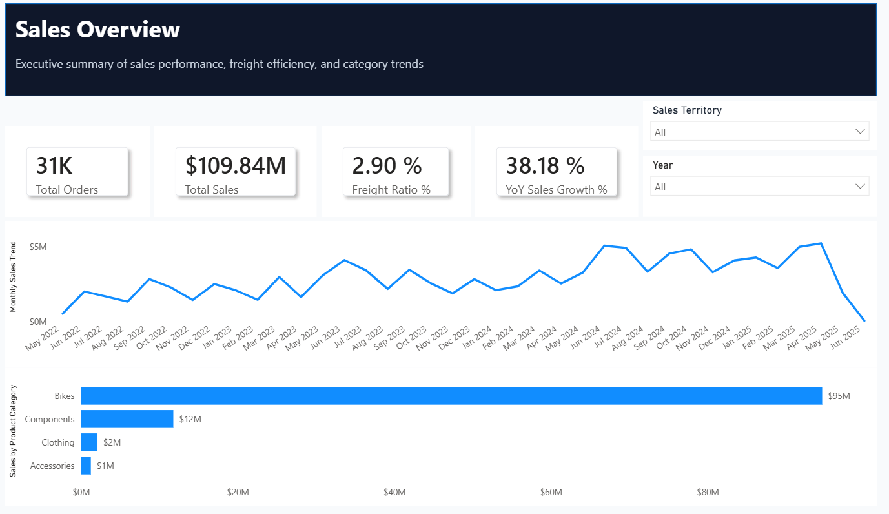
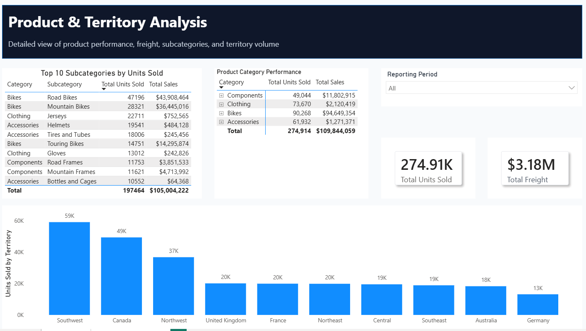
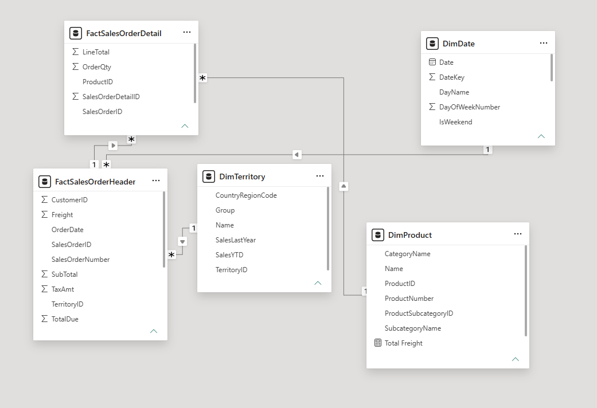

# Power BI Sales Analytics | BI-001

**Version 1.0 — Public Portfolio Edition**

An interactive Power BI report built from Microsoft's AdventureWorks2025 OLTP sample database to analyze sales revenue, order volume, product performance and freight efficiency.

## Business objective

Provide a concise executive sales overview and a detailed product and territory analysis, with consistent measures and interactive reporting periods.

## Report pages

- **Sales Overview:** total orders, sales, freight ratio, YoY sales growth, monthly sales trend and sales by product category; territory and year slicers.
- **Product & Territory Analysis:** units sold, freight, top 10 subcategories by units sold, category/subcategory matrix and territory volume; reporting-period slicer.

## Technical architecture

SQL Server → Power Query → imported semantic model → DAX measures → interactive report.

The model uses order-header and order-line fact tables plus date, product and territory dimensions. Product category and subcategory information was consolidated into DimProduct. DimDate is a calculated calendar with English date labels and numeric sort keys.

| One side | Many side | Join key |
|---|---|---|
| DimDate | FactSalesOrderHeader | Date / OrderDate |
| DimTerritory | FactSalesOrderHeader | TerritoryID |
| FactSalesOrderHeader | FactSalesOrderDetail | SalesOrderID |
| DimProduct | FactSalesOrderDetail | ProductID |

All four relationships are active and single-direction, as reviewed in Power BI Desktop.

## Measures

| Measure | Business definition |
|---|---|
| Total Sales | Sum of order-line LineTotal, excluding freight and tax |
| Total Orders | Distinct order IDs in order details |
| Average Order Value | Selected sales divided by distinct orders |
| Total Units Sold | Sum of order-line OrderQty |
| Total Freight | Sum of order-header Freight |
| Freight Ratio % | Total freight divided by total sales |
| Prior Year Sales | Sales for the corresponding prior-year date context |
| YoY Sales Growth % | Percentage change against the preceding calendar year; see the card help tooltip for year-selection behavior |

## Demonstration results

Unfiltered baseline observed in Power BI Desktop (rounded where indicated):

| Metric | Value |
|---|---:|
| Total Orders | ~31K |
| Total Sales | $109,844,059 |
| Total Units Sold | 274,914 |
| Total Freight | ~$3.18M |
| Freight Ratio | 2.90% |

## Getting started

1. Download `Power_BI_Sales_Analytics_v1.0.pbix` and open it with a compatible current version of Power BI Desktop.
2. Explore the saved imported data using the report slicers and visual interactions.
3. For refresh only, restore AdventureWorks2025 to SQL Server, configure your own server and credentials in Data source settings, and refresh. The development connection used `localhost`.

## Scope and limitations

- This is a sample-data portfolio project, not a production reporting deployment.
- Freight is recorded at order-header level; it is not allocated to individual products. Product-level freight ratios are not supported.
- Under a product filter, average order value represents selected-product revenue per order containing those products.
- The YoY KPI defaults to the latest selected year before the final dataset year when multiple years are selected; single-year selection compares that year to its predecessor. The first and final years may be partial, and the default rule does not independently establish year completeness.
- Desktop testing covered baseline values and date, territory and product interactions. The archived report configuration was inspected separately; the compressed model was not independently recalculated outside Desktop.

## Product preview

### Sales Overview

### Product & Territory Analysis

### Data Model

## Dataset attribution

Source: Microsoft AdventureWorks2025 OLTP sample database, distributed through [Microsoft SQL Server Samples](https://github.com/microsoft/sql-server-samples/releases/tag/adventureworks). The upstream samples are MIT-licensed; see [Microsoft's license notice](https://github.com/microsoft/sql-server-samples/blob/master/license.txt) and the accompanying `DATASET-LICENSE.txt`. This attribution applies to the Microsoft sample material, not a claim that the portfolio author's report is licensed by Microsoft.

## Author

Sebastian Soto Ruiz — [GitHub profile](https://github.com/sebastiansotoruiz19)

Portfolio Lab | Data analytics, business intelligence and continuous improvement.
